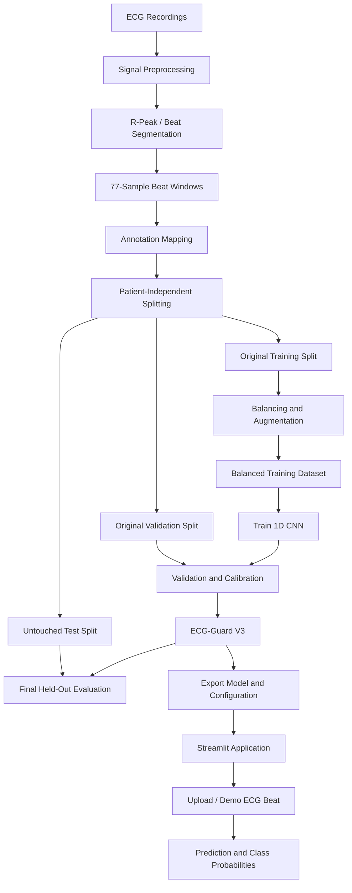
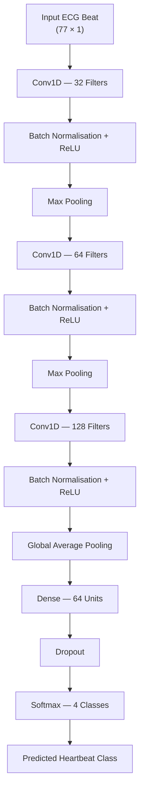
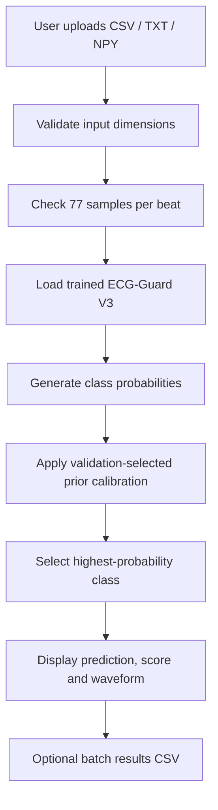
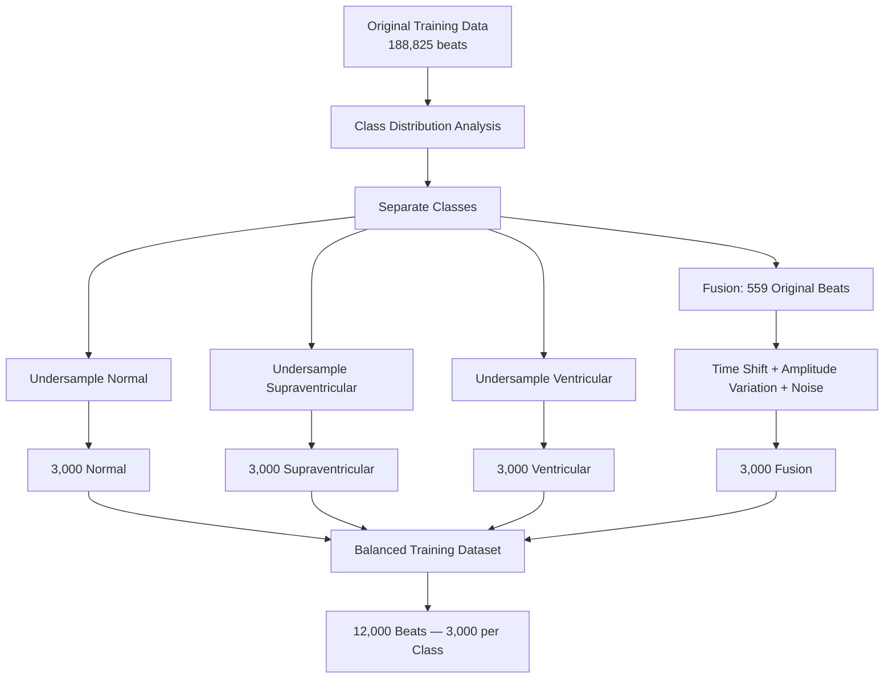

<div align="center">

# 💓 ECG-Guard

### AI-Assisted ECG Heartbeat Classification

**A four-class ECG beat classification system powered by a 1D Convolutional Neural Network and deployed with Streamlit.**

<p>
  
  
  
  
  
  
  
  
</p>

</div>

---

## Table of Contents

1. [Overview](#1-overview)
2. [Problem Statement](#2-problem-statement)
3. [System Architecture](#3-system-architecture)
4. [Dataset](#4-dataset)
5. [Features](#5-features)
6. [Tech Stack](#6-tech-stack)
7. [Project Structure](#7-project-structure)
8. [Installation](#8-installation)
9. [How to Run](#9-how-to-run)
10. [Usage](#10-usage)
11. [Model Evaluation](#11-model-evaluation)
12. [Sample Output](#12-sample-output)
13. [Future Improvements](#13-future-improvements)
14. [Skills Demonstrated](#14-skills-demonstrated)
15. [Author](#15-author)

---

## 1. Overview

**ECG-Guard** is an AI-assisted electrocardiogram (ECG) heartbeat classification project. It uses a one-dimensional Convolutional Neural Network (1D CNN) to classify an individual, preprocessed heartbeat into one of four categories:

| Class ID | Heartbeat class | Description |
|---:|---|---|
| 0 | Normal | Normal heartbeat |
| 1 | Supraventricular | Supraventricular ectopic heartbeat |
| 2 | Ventricular | Ventricular ectopic heartbeat |
| 3 | Fusion | Fusion of normal and ventricular beat |

The selected model, **ECG-Guard V3**, accepts a single-channel waveform containing **77 samples** and returns a predicted class along with class probabilities.

The trained model is integrated into a Streamlit application. Users can upload preprocessed ECG beat data, classify multiple beats in a batch, explore example beats, and view the prediction probabilities and waveform.

> **Important:** ECG-Guard is an academic and educational research prototype. It is not a medical device and must not be used to diagnose, treat, or rule out a medical condition.

## 2. Problem Statement

An ECG records the electrical activity of the heart and is commonly used to study cardiac rhythm. Different heartbeat patterns can indicate different types of cardiac activity.

Automated heartbeat classification is challenging for several reasons:

- ECG signals contain noise and variations in morphology.
- Heartbeat classes can have substantially different numbers of examples.
- Rare arrhythmia classes may be underrepresented in the training data.
- A model can achieve high overall accuracy while performing poorly on minority classes.
- Evaluation must avoid patient-level data leakage to estimate generalisation more reliably.

The project aims to develop a machine-learning pipeline that:

1. Processes ECG recordings and extracts individual heartbeat segments.
2. Maps annotated beats into four target classes.
3. Addresses the severe class imbalance in the training data.
4. Trains and evaluates a 1D CNN using patient-independent data splits.
5. Deploys the selected model through an interactive Streamlit application.

## 3. System Architecture

### 3.1 End-to-end workflow

The following diagram shows the main data and application workflow.



### 3.2 Model architecture

ECG-Guard V3 uses a waveform-only 1D CNN. The input shape is `(77, 1)`.



**Architecture summary:**

`Input → Conv1D(32) → BatchNorm/ReLU → MaxPool → Conv1D(64) → BatchNorm/ReLU → MaxPool → Conv1D(128) → BatchNorm/ReLU → GlobalAveragePooling → Dense(64) → Dropout → Softmax(4)`

The final deployed model uses ECG waveform samples only. RR-interval features were explored during development but are not inputs to this selected deployment model.

### 3.3 Prediction workflow



## 4. Dataset

### 4.1 Original dataset

The primary original reference dataset for this project is the **MIT-BIH Arrhythmia Database**, available through PhysioNet.

- **Dataset:** [MIT-BIH Arrhythmia Database](https://physionet.org/content/mitdb/1.0.0/)
- **Additional recordings in the processed V3 build:** [St Petersburg INCART 12-lead Arrhythmia Database](https://physionet.org/content/incartdb/1.0.0/)

The processed V3 manifest contained **123 recordings: 48 MIT-BIH recordings and 75 INCART recordings**. The MIT-BIH Arrhythmia Database is the original dataset reference; the additional INCART recordings were included in the processed V3 data build.

### 4.2 Why a balanced dataset was created

The original heartbeat data was highly imbalanced. Normal beats formed the majority of the dataset, while Supraventricular and Fusion beats were much less frequent.

Training directly on this distribution can bias a model towards the majority class. A model may then achieve seemingly good accuracy while failing to recognise rare heartbeat categories.

To address this issue, a **separate balanced training dataset was generated and saved in different files**. The model was trained using these balanced training files rather than the original imbalanced training arrays.

### 4.3 Balanced training dataset

The balanced training dataset contains **12,000 beats**, with exactly **3,000 samples per class**.

| Heartbeat class | Balanced training samples |
|---|---:|
| Normal | 3,000 |
| Supraventricular | 3,000 |
| Ventricular | 3,000 |
| Fusion | 3,000 |
| **Total** | **12,000** |

The balancing process used:

- **Undersampling** to reduce the overrepresented classes to the target count.
- **Data augmentation** to increase the Fusion class to the target count.
- The Fusion set contained 559 original examples and 2,441 augmented examples.
- Augmentation operations included controlled time shifting, amplitude variation, and noise addition.

The balanced arrays were saved separately:

- `X_train_balanced_v3.npy`
- `y_train_balanced_v3.npy`

The accompanying balancing metadata and report were saved as:

- `balanced_training_metadata_v3.csv`
- `balancing_report_v3.csv`

### 4.4 Train, validation and test split

The processed V3 dataset was divided into patient-independent splits. The original validation and test sets were **not balanced or augmented**. They retained their natural class distributions so that evaluation would reflect the original data distribution.

| Split | Number of beats | Usage |
|---|---:|---|
| Original training split | 188,825 | Source for balanced training data |
| Balanced training data | 12,000 | Used to train ECG-Guard V3 |
| Validation split | 40,663 | Model selection and calibration |
| Test split | 44,534 | Final held-out evaluation |

**Important data-handling principle:** balancing was applied only to the training data. The validation and test datasets were kept separate and untouched by the balancing process. Patient-independent splitting was used to reduce the risk of the same patient's beats appearing across training, validation, and test splits.

### 4.5 Natural test-set class distribution

The complete held-out test set contained the following class distribution:

| Class | Test samples |
|---|---:|
| Normal | 39,798 |
| Supraventricular | 572 |
| Ventricular | 4,114 |
| Fusion | 50 |
| **Total** | **44,534** |

This distribution is intentionally shown in its original, imbalanced form. It is important when interpreting accuracy and minority-class performance.

### 4.6 Data preprocessing

The processed V3 pipeline used the following main steps:

1. Read ECG signals and their beat annotations.
2. Select the available ECG lead (MLII was preferred for MIT-BIH, with a configured fallback; lead II was used for INCART).
3. Resample the signals to **128 Hz**.
4. Apply a fourth-order Butterworth band-pass filter with a **0.5–40 Hz** passband using zero-phase filtering.
5. Segment each heartbeat using a window of approximately **0.2 seconds before** and **0.4 seconds after** the annotated R-peak.
6. Represent each heartbeat using **77 samples**.
7. Map annotations into Normal, Supraventricular, Ventricular, and Fusion classes.

### 4.7 Dataset balancing workflow



## 5. Features

### Machine Learning

- Four-class ECG heartbeat classification.
- 1D CNN-based waveform classification.
- Separate balanced training dataset.
- Minority-class augmentation.
- Patient-independent train, validation and test splitting.
- Validation-based prior calibration.

### Streamlit Application

- Upload a preprocessed ECG beat in `.csv`, `.txt`, or `.npy` format.
- Classify one beat or multiple beats in a batch.
- Paste 77 numeric sample values directly into the application.
- Explore built-in example beats when `demo_beats.npz` is available.
- View the predicted heartbeat class and model score.
- Visualise class probabilities.
- View the uploaded ECG waveform.
- Download batch prediction results as a CSV file.

## 6. Tech Stack

| Technology | Purpose |
|---|---|
| Python | Main programming language |
| TensorFlow | Deep learning framework |
| Keras | 1D CNN model development and inference |
| NumPy | Numerical operations and ECG arrays |
| Pandas | Dataset handling and prediction tables |
| SciPy | ECG signal filtering and signal processing |
| WFDB | Reading ECG records and annotations |
| scikit-learn | Dataset splitting and evaluation metrics |
| Matplotlib | Signal and evaluation visualisation |
| Streamlit | Interactive web application |

## 7. Project Structure

### 7.1 Streamlit deployment folder

```text
ECG_Guard_Streamlit/
│
├── app.py
├── requirements.txt
├── README.md
├── deployment_config.json
│
└── models/
    ├── ecg_guard_final.keras
    └── demo_beats.npz          # Optional demo examples
```

| File | Purpose |
|---|---|
| `app.py` | Streamlit interface, input validation and model inference |
| `requirements.txt` | Python dependencies for the application |
| `deployment_config.json` | Model metadata, class names and validation-selected calibration settings |
| `models/ecg_guard_final.keras` | Trained ECG-Guard V3 model |
| `models/demo_beats.npz` | Example beats used by the demo tab |

### 7.2 Important training and dataset artifacts

The processed dataset was stored separately from the Streamlit application, under the `processed_v3` directory.

```text
processed_v3/
│
├── X_train_balanced_v3.npy
├── y_train_balanced_v3.npy
│
├── X_validation_v3.npy
├── y_validation_v3.npy
├── X_test_v3.npy
├── y_test_v3.npy
│
├── beat_metadata_v3.csv
├── balanced_training_metadata_v3.csv
├── balancing_report_v3.csv
│
├── ecg_guard_final.keras
├── best_ecg_guard_v3.keras
│
└── streamlit_deployment/
    ├── ecg_guard_final.keras
    ├── deployment_config.json
    ├── demo_beats.npz
    └── test_metrics.json
```

The large dataset arrays and model files are generated artifacts and may be stored separately from the source-code repository.

## 8. Installation

### Prerequisites

- Python **3.12** recommended.
- pip.
- Git (optional, for cloning the repository).
- The trained model file `ecg_guard_final.keras`.
- The deployment configuration file `deployment_config.json`.

### Step 1: Clone the repository

```bash
git clone <YOUR_GITHUB_REPOSITORY_URL>
cd ECG_Guard_Streamlit
```

If you already have the project folder, simply open a terminal in that directory.

### Step 2: Create a virtual environment

Linux / macOS:

```bash
python3.12 -m venv .venv
source .venv/bin/activate
```

Windows:

```powershell
py -3.12 -m venv .venv
.venv\Scripts\activate
```

### Step 3: Upgrade pip

```bash
python -m pip install --upgrade pip
```

### Step 4: Install dependencies

```bash
pip install -r requirements.txt
```

### Deployment requirements

The application runtime uses the following dependencies:

```text
streamlit>=1.40,<2
tensorflow==2.21.0
numpy>=1.26,<2.2
pandas>=2.0,<3
```

Signal-processing and training dependencies such as WFDB, SciPy, and scikit-learn are needed when reproducing the data-preparation or model-training pipeline; they are not required for the basic Streamlit inference workflow.

### Step 5: Add model files

Make sure the trained model is placed at:

```text
models/ecg_guard_final.keras
```

Place `deployment_config.json` in the project root. If you want to use the demo tab, also place `demo_beats.npz` inside `models/`.

## 9. How to Run

After installing the dependencies and adding the model files, run:

```bash
streamlit run app.py
```

Streamlit will display a local URL in the terminal, usually:

```text
http://localhost:8501
```

Open the URL in your browser to use ECG-Guard.

To stop the application, press `Ctrl + C` in the terminal.

## 10. Usage

### Option 1: Upload a single ECG beat

1. Open the **Classify ECG beat** tab.
2. Upload a `.csv`, `.txt`, or `.npy` file.
3. Ensure the file contains exactly 77 numeric samples for one beat.
4. Click **Run ECG classification**.
5. View the predicted class, model score, class probabilities, and ECG waveform.

### Option 2: Batch classification

For batch prediction, provide one beat per row, with 77 numeric values in each row.

Example CSV structure:

```csv
0.02,0.05,0.11,0.18,0.24,...,0.03
0.01,0.04,0.10,0.16,0.22,...,0.02
0.03,0.06,0.12,0.19,0.25,...,0.04
```

Each row must contain exactly 77 values. The application displays the predictions in a table and provides an option to download the results as a CSV file.

### Option 3: Paste values manually

1. Open the **Classify ECG beat** tab.
2. Expand the manual input section.
3. Paste exactly 77 comma- or space-separated numeric values.
4. Click **Run ECG classification**.

### Option 4: Try a demo beat

Open the **Try a demo beat** tab, select an available example, and click **Classify selected demo beat**.

### Input format limitation

The current Streamlit application expects an **already-preprocessed and beat-segmented waveform of 77 samples**.

It does not currently accept a raw 10-second ECG recording or a WFDB `.dat` / `.hea` record pair. R-peak detection, filtering, and raw-recording preprocessing are part of the dataset preparation workflow, not the deployed application.

## 11. Model Evaluation

### 11.1 Model selection

ECG-Guard V3 was selected after comparing model versions on a 3,000-sample stratified validation subset.

| Model | Validation accuracy | Balanced accuracy | Macro F1 |
|---|---:|---:|---:|
| **ECG-Guard V3** | **65.97%** | 55.38% | **45.81%** |
| ECG-Guard V4 | 63.57% | **57.96%** | 45.56% |

V3 was selected based on its stronger validation accuracy and Macro F1. The separate full-data experiment was not retained because it showed substantial training/validation overfitting.

### 11.2 Final held-out test results

The selected ECG-Guard V3 model was evaluated on the complete, original **44,534-beat test set**.

<details>
<summary><strong>Recorded full-test metrics — raw model predictions</strong></summary>

| Evaluation metric | Result |
|---|---:|
| Accuracy | **78.08%** |
| Balanced Accuracy | **59.21%** |
| Macro Precision | **40.34%** |
| Macro Recall | **59.21%** |
| Macro F1-score | **40.73%** |

</details>

The validation-selected prior calibration strength used by the deployed application is **α = 0.175**. Calibration was selected using validation data, not by tuning against the held-out test set.

### 11.3 Interpreting the results

- The 78.08% accuracy indicates the proportion of correctly classified beats across the complete test set.
- Balanced accuracy and Macro F1 are important because the test set is highly imbalanced.
- The model performs better on some classes than on rare classes.
- Minority-class recognition, particularly for Supraventricular and Fusion beats, remains a key limitation.

**The reported metrics should not be interpreted as evidence of clinical reliability.** Further validation on independent datasets and clinical review would be required before any real-world medical use.

## 12. Sample Output

The Streamlit application displays the predicted class, model score, probability distribution, and input waveform.

### Illustrative prediction format

> The values below demonstrate the output layout only. They are not a recorded test prediction.

| Output field | Illustrative value |
|---|---|
| Predicted beat class | Normal |
| Model score | 82.0% |
| Normal probability | 82.0% |
| Supraventricular probability | 8.0% |
| Ventricular probability | 7.0% |
| Fusion probability | 3.0% |

A batch prediction table contains:

| Beat | Prediction | Model score |
|---:|---|---:|
| 1 | Normal | 82.0% |
| 2 | Ventricular | 76.0% |
| 3 | Supraventricular | 68.0% |

*All values in these sample tables are illustrative. Actual predictions depend on the uploaded ECG beat.*

## 13. Future Improvements

- Improve minority-class recognition, especially Supraventricular and Fusion beats.
- Explore focal loss, class-aware sampling, and improved augmentation strategies.
- Evaluate alternative architectures such as residual CNNs, CNN-LSTM, and attention-based models.
- Add raw ECG recording support with automatic filtering, R-peak detection, and beat segmentation.
- Support WFDB `.dat` and `.hea` inputs.
- Expand external validation across more patients and datasets.
- Improve confidence estimation and probability calibration.
- Add model explainability and beat-level visual interpretation.
- Conduct rigorous clinical validation before considering any clinical application.

## 14. Skills Demonstrated

- ECG signal processing and biomedical data handling.
- Working with PhysioNet ECG datasets and WFDB.
- Digital filtering and heartbeat segmentation.
- Handling highly imbalanced datasets.
- Undersampling and minority-class data augmentation.
- Patient-independent dataset splitting.
- Deep learning with TensorFlow and Keras.
- 1D CNN architecture design and model selection.
- Classification evaluation using Accuracy, Balanced Accuracy, Precision, Recall, and Macro F1.
- Probability calibration and inference pipelines.
- Streamlit application development.
- Model export, dependency management, and deployment.

## 15. Author

### Project Contributors

| Name | Enrollment number |
|---|---|
| Samarth Gupta | 24/11/EE/012 |
| Ramji | 24/11/EC/025 |
| Devananda Sreekumar | 24/11/EE/036 |
| Priyanshu Kumar Ajariwal | 24/11/EE/005 |

---

<div align="center">

**ECG-Guard — AI-assisted ECG heartbeat classification**

*Built as an academic machine-learning and software deployment project.*

**For research and educational use only. Not for clinical diagnosis.**

</div>
